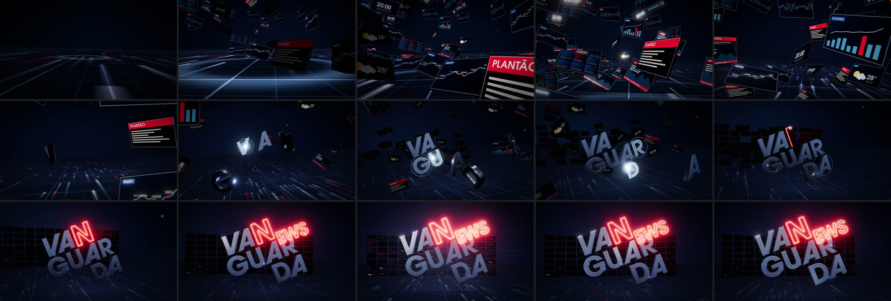

# VANGUARDA NEWS — remake RVA (Remaking Vintage Archives)

Vinheta independente, **inteiramente programada**: animação em Three.js (WebGL) com
curvas de movimento da biblioteca **Motion**, renderizada quadro a quadro num
Chromium headless e codificada com **FFmpeg**. Trilha **original**, sintetizada em
Python. Nenhuma imagem, cena ou áudio da vinheta histórica é reutilizado — dela
foi usada apenas a **geometria da composição final da logo**.

| Entrega | Valor |
|---|---|
| Arquivo | `output/RVA_Vanguarda_News_2160p30.mp4` |
| Vídeo | H.264 High@5.1, **3840×2160 (UHD 4K)**, 16:9, **30 fps**, 4:2:0, BT.709 |
| Áudio | AAC 320 kb/s, 48 kHz estéreo, −14 LUFS integrados, pico ≤ −1 dBTP |
| Duração | 10,5 s (315 quadros) |

## Conceito: "o sinal vira notícia"

Uma única viagem de câmera, sem cortes, em cinco atos sincronizados com a trilha
(120 BPM, 1 tempo = 0,5 s):

| Tempo | Ato | Imagem | Música |
|---|---|---|---|
| 0,0–2,0 s | **Sinal** | Câmera rasante sobre um piso-grade escuro; feixes de dados correm para o horizonte; ondas de radar a cada tempo; as telas da redação **ligam exatamente em cada blip** | Pad em Ré menor crescendo, pulso de dados em semicolcheias, blips |
| 2,0–4,0 s | **Redação** | A câmera sobe e atravessa um túnel de telas (Ao Vivo, Plantão, Região com o rio Paraíba do Sul e as cidades do Vale, Economia, Tempo, Sinal, Relógio). **Cada bumbo vira um grupo de telas** (mola Motion) | Entram bumbo e baixo (Dm → B♭) |
| 4,0–6,0 s | **Forja** | As telas se abrem como cortina e voam para formar o painel de fundo; as letras cromadas **V A G U A R D A** cruzam o espaço e travam no lugar, **uma por colcheia**, com anel de choque, faíscas e recuo elástico | 8 impactos metálicos (FM) + metais em Gm → E♭ |
| 6,0–8,0 s | **Ignição** | O neon do **N** se desenha (6,0–6,9 s) com faísca na ponta e piscadas de ignição; depois **E, W, S** (7,0–7,75 s). Em 7,75 s a energia cai e o neon tremula | Zumbido elétrico, rufo acelerando, riser; Asus4 → A; pausa dramática |
| 8,0–10,5 s | **Assinatura** | **Impacto em 8,0 s**: flash, flares anamórficos, onda de luz no piso e no painel. O eco "EW" acende em 8,5 s; uma faixa de luz varre o cromado (8,75–10,4 s). A câmera segue num push-in lento até o último quadro (sem congelar) | Acorde final em Ré maior (metais, cordas, tímpano, prato), sinos em 8,5 s e 8,75 s |

## Geometria da logo (única referência histórica usada)

As proporções foram **medidas automaticamente** no último quadro da referência
(`tools/reference_fit/`): ajuste de silhueta das linhas `VA` / `GUAR` / `DA` (faces
cromadas, IoU 0,80) e do contorno de neon `N` + `EWS` + eco `EW`. Resultado em
`tools/reference-fit.json`, consolidado em `assets/logo-geometry.json`:

- Inclinação da composição: **21,88°** (sobe para a direita).
- Linhas prateadas na mesma escala; passo entre linhas ≈ 843 unidades (capitular 740).
- Deslocamentos: `GUAR` −200 u, `DA` +1330 u em relação a `VA`; espaçamentos 10 / −35 / −80.
- `N` de neon com 1,10× a altura das letras cromadas; `EWS` com 0,67×; eco `EW` com 0,38×.
- Fonte ITC Avant Garde Std Bold com os caracteres especiais fornecidos:
  **V = U+E04F (`V.alt02`)** e **A = U+E000 (`A.alt01`)**, com o kerning GPOS do par V/A (−275).

Verificação no quadro final renderizado (`tools/geometry_check.py`): rotação na
tela 21,8°; desvio de perspectiva **0,26 % RMS** (máx. 0,66 %) da diagonal da logo,
ou seja, sem distorção, esticamento ou compressão; logo centralizada (≈ 51 % × 50 %),
ocupando ~50 % da largura e ~70 % da altura do quadro.

## Controle de qualidade (render final)

| Verificação | Resultado |
|---|---|
| Arquivo | 3840×2160, SAR 1:1 / DAR 16:9, H.264 High@5.1, 30/1 fps, **315 quadros**, ~40 Mb/s, 52,6 MB |
| Duração | vídeo 10,500 s e áudio 10,500 s, ambos iniciando em 0,000 s |
| Decodificação integral | sem erros (`ffmpeg -v error -f null`) |
| Tela preta | nenhum quadro abaixo de luminância 4 (mín. 6,0 no 1º quadro, abertura em fade) |
| Quadros congelados | nenhum; os últimos quadros seguem em movimento (push-in, neon, poeira) |
| Saltos/pops | um único pico, no quadro 240 = **flash do impacto em 8,000 s** (intencional) |
| Sincronia | 8 travamentos de letras, bumbos e impacto final dentro de **±2,5 ms** do ataque no áudio |
| Proporções da logo | rotação 21,8° (ref. 21,88°), distorção 0,26 % RMS / 0,66 % máx., centro (51 %, 50 %) |
| Áudio | −14,0 LUFS integrados, pico −0,9 dBFS |



## Estrutura

```
vinhetas/vanguarda-news/
├── src/
│   ├── main.js        # cena, câmera, timeline (cada quadro = função pura de t)
│   ├── timeline.js    # helpers sobre Motion: interpolate, easings, spring, cubicBezier
│   ├── logo.js        # letras cromadas extrudadas + tubos de neon (desenho progressivo)
│   ├── world.js       # céu, ambiente PMREM, piso, feixes, telas, poeira, impactos
│   ├── panels.js      # conteúdo das telas (Canvas 2D procedural)
│   ├── post.js        # bloom HDR, ACES, vinheta, dither
│   └── entry.js       # API window.RVA usada pelo renderizador
├── render/
│   ├── page.html
│   └── render.mjs     # Playwright + servidor local + FFmpeg (master sem perdas → MP4)
├── tools/
│   ├── compose_music.py    # trilha original (numpy) + assets/cues.json
│   ├── extract_glyphs.py   # contornos dos glifos + caminhos de neon (fontTools, shapely)
│   ├── geometry_check.py   # QA de proporções no quadro final
│   ├── motion_check.py     # QA de fluidez (pops, congelamento, tela preta)
│   ├── reference-fit.json  # medidas da composição histórica
│   └── reference_fit/      # scripts de medição (o vídeo de referência não é distribuído)
├── assets/
│   ├── logo-geometry.json
│   ├── cues.json            # mapa de sincronia gerado pela trilha
│   ├── audio/vanguarda-news-theme.wav
│   └── fonts/               # (não versionado) ITC Avant Garde Std Bold/Demi
└── output/
    ├── RVA_Vanguarda_News_2160p30.mp4
    └── contact_sheet.jpg
```

## Como renderizar

Requisitos: Node 22+, Python 3 com `numpy`, `fonttools`, `shapely`, FFmpeg com
libx264, Playwright/Chromium. As fontes ITC Avant Garde Std (comerciais) devem
ser copiadas para `assets/fonts/` (`ITCAvantGardeStd-Bold.ttf`, `ITCAvantGardeStd-Demi.ttf`).

```bash
npm install
python3 tools/extract_glyphs.py        # gera assets/logo-geometry.json
python3 tools/compose_music.py         # gera a trilha e assets/cues.json
node render/render.mjs --width 960 --contact      # folha de contato rápida
node render/render.mjs                 # render final 3840x2160 (≈ 20–30 min em CPU)
node render/render.mjs --encode-only --crf 16     # recodifica a partir do master sem perdas
python3 tools/motion_check.py output/RVA_Vanguarda_News_2160p30.mp4
```

O render é determinístico (sementes fixas): a mesma versão do código gera os
mesmos quadros. Sem GPU, o WebGL roda via SwiftShader.
